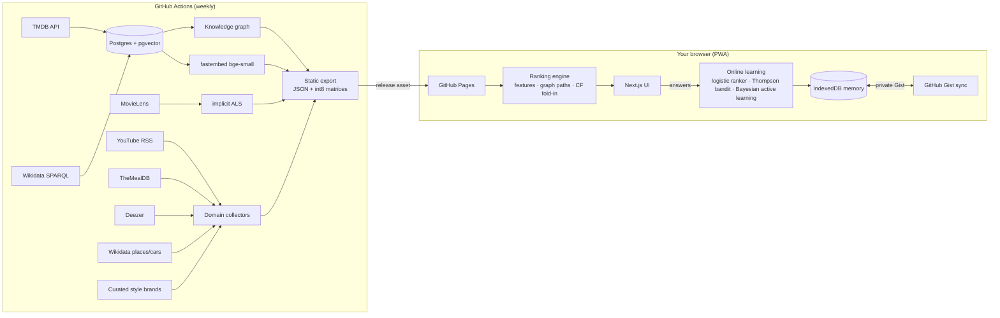

# CineGraph

**A personal taste engine.** Films, series, documentaries, YouTube, music, recipes, travel, cars and style in
one app that learns what *you* like from a few swipes, explains every recommendation, and remembers
everything across devices. No server: it runs entirely in your browser, on GitHub Pages.

**Live:** https://polluxgnr.github.io/cinegraph/ · install it from the browser menu ("Install app") to get it on your phone.

[](https://github.com/Polluxgnr/cinegraph/actions/workflows/ci.yml)
[](https://github.com/Polluxgnr/cinegraph/actions/workflows/pages.yml)
[](https://github.com/Polluxgnr/cinegraph/actions/workflows/data.yml)
[](docs/ARCHITECTURE.md#measured-quality)

**One app, seven spaces.** Pick a space in the sidebar (Films & series, Videos & docs, Music, Recipes,
Destinations, Dream garage, Style) and the whole app becomes about it: its own home, swipe deck,
search, list, taste profile and colour. In English or French (Settings → Appearance and language, or your
browser's language), dark by default with a light option.

| | |
|---|---|
| **Swipe** with two-step answers: *seen?* → all-time favourite / loved / liked / ok / not my thing / dropped it (+ reaction chips such as "Too long"), or *not seen* → must watch soon / add to my list / could be down / not now (comes back in 30 days) / no idea / never. Videos use 👍 / 👎 like YouTube. The next card is chosen by **active learning**. | **For you**: every card shows a predicted rating, a match %, and *why*: "Same writer (Jonathan Nolan) as Interstellar, which you loved". Plus "Because you loved X" rows. |
| **Bring your history**: YouTube (Google Takeout: watch history, subscriptions, Watch later), Spotify (data export, or live login: top artists, liked songs, playlists), Netflix viewing activity, Letterboxd, public Pinterest boards, and JSON *packs* (e.g. sorted Instagram saves). Parsed in the browser. | **Add your own**: paste any link (brand site, track, playlist, recipe blog, video); title and image are fetched, it gets a borrowed embedding and shapes your profile like everything else. |
| **Useful from the first visit**: before you've answered much, predictions start from the crowd (TMDB rating shrunk by vote count, popularity elsewhere) and your own model takes over answer by answer. | **New releases & prices**: a weekly *New releases* row in Music (Deezer charts + the latest records of the catalogue's artists, ranked by how much you like each artist); approximate prices on dream cars (new, market value or "from") and on iconic clothing pieces; video length, views, likes and comments. |
| **Hear it, watch it**: swipe cards play a 30 s preview of the artist's most played song (Deezer) or open the film's trailer; artist pages list the most played songs with previews, fans, albums, singles and who their fans also play. | **Playlists, improved**: paste a Deezer or Spotify playlist; it maps the artists, suggests songs that fit (from who the playlist's artists' fans also play, weighted by your taste, with previews) and flags tracks by artists you rejected. |
| **Places worth the trip, and the trip itself**: each destination shows its best spots on a map, live from Wikidata (museums, landmarks, nature, food…), filming locations of films you loved first. Add spots to a trip, set the days, and *Plan my days* groups nearby spots per day and orders each day as a walk, with routes, distances, Google Maps directions, notes and a "been there" check. | **Style, piece by piece**: every brand page groups its pieces by category, links each category on the brand's own site, Vinted and Grailed, and lets you add pieces with a price. Searching a label that isn't in the catalogue (Mertra, Jacker...) finds its site and adds it. |
| **Where every number comes from**: film pages show each source's score (TMDB audience, MovieLens individual ratings, Rotten Tomatoes, Metacritic, IMDb as recorded on Wikidata, with dates and links), the Wikipedia summary, the trailer, and *Why 85%*: how much each signal (your taste, people like you, cast & crew, critics…) pushed the score, and how much still comes from the crowd. | **Connections**: Settings lists every source with its status, what it brings and when it last ran: your accounts (GitHub sync, Spotify, YouTube, Netflix, Letterboxd, Pinterest, Instagram packs, Claude) and the open sources behind the catalogue. |
| **Profiles & Pick together**: several people on one device, each with their own memory (no login). *Pick together* ranks what two profiles will both like (by the weaker of the two matches) and has a swipe-to-agree mode: two yeses put it on both lists. | **Search everywhere**: titles (also by their French title), directors, cast and themes, ranked by where the words hit, then by your predicted match; search *People*, *Directors* or *Actors* only. Videos filter by theme (nature, geopolitics, history, science…); recipes by cuisine, main ingredient, 🌱 vegetarian / 🌿 vegan, or any ingredient you type. |
| **People**: every title page shows the cast & crew with photos and characters; each person has a page with their biography (Wikipedia), what of theirs is in the catalogue ranked for you, and their whole career (Wikidata). **Follow** an actor or director and their films count like two you loved (avoid: two you disliked). | **Ratings you can compare**: every score out of 10 with one decimal (IMDb from its official dataset, TMDB, MovieLens, Metacritic, Rotten Tomatoes' average; the Tomatometer stays a %). Videos get a viewer score /10 (likes per view against the other videos, damped for small audiences). The swipe deck has filters: type, decade, length, minimum rating, original language, genres, your services. |
| **Continue**: series in progress (season/episode tracker) and **sagas** (Harry Potter, Star Wars…) with progress bars; **Tonight** by mood × your streaming services in France, with legal watch links. | **Second brain**: links and ideas (share from your phone into the app), an **AI-ready taste dossier** (one Markdown document of your whole taste to paste into any assistant), and an **Obsidian** export. |

## Why it's built this way



- **Heavy, slow work offline; personal, fast work on-device.** Crawling, entity resolution, embeddings and
  matrix factorisation run weekly in CI. Personalisation (profile, ranking, learning) runs in the browser
  in milliseconds, so the app is free to host, works offline, and your data never touches a server.
- **Hybrid recommender, explainable by construction.** Content embeddings, collaborative filtering and
  knowledge-graph paths are *features*; a logistic ranker learns how much each matters *to you*, online,
  from each answer. The best graph path becomes the explanation.
- **Learns fast from zero data.** The swipe deck maximises information gain (Bayesian linear regression on a
  random projection of the embeddings) weighted by how likely you are to know the item, then shifts towards
  exploitation as evidence accumulates. Thompson sampling keeps a small exploration budget in every list.
- **Modular.** Each taste domain is one collector file in Python and one config entry in TypeScript; the same
  engine, card and swipe deck serve all of them.

- **Measured, not claimed.** Every week the pipeline hides 20% of what 2,000 MovieLens users loved and checks
  whether each method finds it again (HR@10, NDCG@10, Recall@20): most popular, content, collaborative
  filtering and the hybrid. The result is in the badge above and on the Taste page, and it sets the ranker's
  starting weights.

Details, maths and trade-offs: [docs/ARCHITECTURE.md](docs/ARCHITECTURE.md). Navigation map: [docs/NAVIGATION.md](docs/NAVIGATION.md).
Latest audit and what to build next: [docs/AUDIT.md](docs/AUDIT.md).

## Engineering

| | |
|---|---|
| **Tests** | `backend`: pytest (ingestion, matching, ranking, evaluation protocol, export formats, a Postgres end-to-end pipeline). `web`: Vitest (engine maths, sync merges incl. deletions, trip planning, calendar export, swipe filters, ratings, recipe diets and variations, video scores) and **Playwright** end-to-end tests on the static build, desktop and phone (navigation, swipe fits the screen and its filters persist, search and people pages, film sources, French interface, profiles, trip planning, recipes, no CSP violations). All run in CI on every push. |
| **Security** | No server and no account: memory lives in your browser and, optionally, a private Gist. Tokens are AES-GCM encrypted at rest with a non-extractable browser key; a Content-Security-Policy limits where the page can send data; new devices pair by QR code (expires in 2 minutes). Secrets are never synced or exported. |
| **Performance** | Film catalogue in a compact format (link ids instead of URLs, poster paths) with details in 64 shards loaded on demand, 192-d PCA embeddings: about 6 MB on a first visit, cached by the service worker afterwards. Recommendations are computed on-device in milliseconds. |
| **Sync** | Read-merge-write rounds per profile; deletions are recorded (tombstones) so they propagate; the latest answer wins per item. |
| **Data pipeline** | Weekly GitHub Actions run: resumable TMDB crawl, MovieLens 32M, Wikidata, trailers, embeddings, ALS, evaluation, static export; a source that fails keeps last week's data. |

## Use it

1. Open the site, pick a space in the sidebar, go to **Swipe** and answer ~40 cards. Every answer updates the next card and every list.
2. **Import & connect**: drop your YouTube Takeout, Spotify data export, Netflix viewing history or Letterboxd ZIP.
3. **+ Add** (in any space): paste links to things you like. Pinterest boards and packs go through **Import & connect**.
4. **Profile menu** (top of the sidebar): add a profile per person, then **Pick together**.
5. **Settings → Memory & sync**: paste a GitHub token (classic, `gist` scope only) once; every profile on that
   device syncs to one private Gist, pulled when the app opens and pushed seconds after each answer. **Link another
   device** sends your iPad or phone a one-tap link, so it needs no token of its own. Or download a JSON backup.
6. Optional: **Anthropic API key** (smarter search and a written taste portrait). **Second brain → Copy my taste dossier** gives any AI your full profile.

### Where things live

| What | Where |
|---|---|
| The app | GitHub Pages (static files, no server), installable as a PWA |
| The catalogue (films, music, places…) | `data.tar.gz` on the `data-latest` GitHub release, rebuilt weekly by GitHub Actions |
| The pipeline's database | Postgres inside the Actions run, carried between runs in the Actions cache (never public) |
| Your memory (answers, lists, notes) | Your browser (IndexedDB), and if you turn sync on, a **private Gist** on your own GitHub account |
| Live extras | Deezer (previews, artists, playlists), Wikidata (spots), YouTube (trailers), Spotify / Google (only with your own login) |

Swipe on your phone, open your laptop: with sync on, the laptop pulls the phone's answers when the app opens or
comes back to the foreground, and both sides are merged (the most recent answer wins for the same title). Without
sync, each browser keeps its own memory; the sidebar always says which.

### Data sources (all legal, open or official)

| Area | Source | Notes |
|---|---|---|
| Films & series | TMDB API (needs a free key, see below; also official trailers, French titles and synopses, cast photos), Wikidata, Wikipedia images and biographies, MovieLens 32M (32 million ratings from 200,000 people: the collaborative-filtering signal), IMDb ratings from IMDb's [non-commercial datasets](https://developer.imdb.com/non-commercial-datasets/) | Links to SensCritique, AlloCiné, Letterboxd, IMDb via Wikidata ids; Letterboxd and SensCritique publish no open ratings, so they are linked, not scored; no scraping |
| Where to watch | TMDB watch providers (JustWatch data), France | Subscriptions + free (arte.tv, france.tv); never piracy sites |
| Videos & docs | Official YouTube RSS of ARTE, France 5, franceinfo, Ushuaïa TV, Kurzgesagt, Veritasium, DW… (views, likes) + optional YouTube Data API key (`YOUTUBE_API_KEY` secret: length, comments) + **Connect YouTube** in the browser (your Google OAuth client: liked videos, subscriptions, playlists) | Curated in `backend/cinegraph/config/youtube_channels.yaml` |
| Music | Deezer public API (artists, genres, related artists; in the browser: top songs, 30 s previews, fans, albums, playlists, and *New from your artists*: releases of the last 90 days by your Spotify top artists) + your Spotify (PKCE, in-browser: top artists, liked songs, playlists, each playlist analysed in one tap) | Exact stream counts aren't published by any open API; Deezer's popularity rank and fan counts are shown instead. Spotify's own recommendation endpoints are closed to new apps, so suggestions come from Deezer's related artists weighted by your taste |
| Recipes | TheMealDB (cuisine, category, ingredients, steps) | Vegetarian / vegan and main ingredient are read from the ingredient list; *Variations* = the same dish elsewhere and recipes sharing most ingredients. Marmiton has no API: search links + save Marmiton pages to the vault |
| Travel, dream garage | Wikidata + Wikimedia Commons photos; best spots per place queried live from the Wikidata SPARQL endpoint; maps from OpenStreetMap (Leaflet) | Cars are a curated dream list (makes, models, classes), not every car on the road; approximate prices in `config/car_prices.yaml` |
| Style | Curated design, underground and streetwear brands (`config/style_brands.yaml`) with their site's own preview image, and iconic pieces with approximate retail prices (`config/style_pieces.yaml`) linked to their brand | Links to shopping search, Pinterest, Instagram and Vinted; add yours or import Pinterest boards. Shop product feeds are not used: most stores block automated clients |
| Pinterest | Public board RSS (latest ~25 pins per board, re-sync for new ones) | Public boards only; no login, no scraping |

## Setup (owner)

**TMDB key (posters, cast, keywords, streaming availability).** Create a free account at themoviedb.org →
Settings → API → *Create → Developer* → copy the **API Read Access Token**. Then in this repository:
*Settings → Secrets and variables → Actions → New repository secret* → name `TMDB_API_KEY`. Run the
**Build catalogue** workflow (Actions tab → Run workflow); it redeploys the site when done.
Without the key the catalogue still builds from MovieLens + Wikidata (images from Wikipedia).

**Local development**

```bash
# web app (needs web/public/data: run the export below, or download data.tar.gz from the data-latest release)
cd web && npm install && npm run dev            # http://localhost:3000

# data pipeline
docker compose up -d db                          # Postgres 16 + pgvector on 127.0.0.1:5433
cd backend && uv venv --python 3.12 .venv && uv pip install -e ".[dev]"
.venv/Scripts/cinegraph init-db                  # (.venv/bin/... on Linux/macOS)
.venv/Scripts/cinegraph ingest movielens
.venv/Scripts/cinegraph ingest tmdb --top-movies 3000 --top-tv 1500   # with TMDB_API_KEY in .env
.venv/Scripts/cinegraph ingest wikidata --tv-bootstrap 1200
.venv/Scripts/cinegraph ingest links
.venv/Scripts/cinegraph build graph && .venv/Scripts/cinegraph build embeddings && .venv/Scripts/cinegraph build cf
.venv/Scripts/cinegraph export-static            # -> web/public/data
```

**Tests**: `cd backend && pytest` (matchers, CSV formats, TMDB parsing + rate limiting, ranking, active learning,
collectors, quantisation, a Postgres end-to-end pipeline test) and `cd web && npm test` (engine: linear algebra,
int8 decoding, ranking, online learning, active learning, title normalisation parity, query parsing).

## Add a taste domain

1. `backend/cinegraph/domains/<name>.py`: return a list of `Item(id, title, image, tags, text, url, …)`.
2. Register it in `DOMAINS` in `backend/cinegraph/export_static.py`.
3. Add its labels and answer options in `web/lib/domains.ts`.

Swipe, recommendations, lists, taste summary and Obsidian export work for it automatically.

## Repository

```
backend/   Python data & ML pipeline (ingestion, knowledge graph, embeddings, ALS, static export, tests)
web/       Next.js static PWA: engine (lib/engine), memory & sync (lib/store, lib/sync), UI (app/)
docs/      Architecture notes
.github/   CI, weekly catalogue build, Pages deploy
```

Data credits: TMDB (this product uses the TMDB API but is not endorsed or certified by TMDB), Wikidata &
Wikimedia Commons, MovieLens (GroupLens, non-commercial research use: the ratings are never published; only
derived model factors and per-film averages are, and a commercial use would require removing them),
TheMealDB, Deezer API, YouTube.
