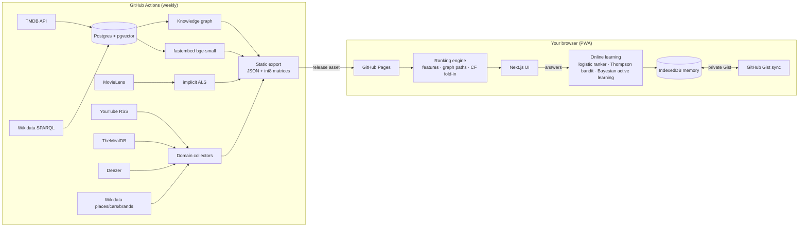

# CineGraph

**A personal taste engine.** Films, series, documentaries, YouTube, music, recipes, travel, cars and style in
one app that learns what *you* like from a few swipes, explains every recommendation, and remembers
everything across devices. No server: it runs entirely in your browser, on GitHub Pages.

**Live:** https://polluxgnr.github.io/cinegraph/ · install it from the browser menu ("Install app") to get it on your phone.

[](https://github.com/Polluxgnr/cinegraph/actions/workflows/ci.yml)
[](https://github.com/Polluxgnr/cinegraph/actions/workflows/pages.yml)
[](https://github.com/Polluxgnr/cinegraph/actions/workflows/data.yml)

| | |
|---|---|
| **Swipe** with two-step answers: *seen?* → loved / liked / ok / not my thing (+ reaction chips such as "Too long"), or *not seen* → add to my list / could be down / no idea / never. The next card is chosen by **active learning**. | **For you**: every card shows a predicted rating, a match %, and *why*: "Same writer (Jonathan Nolan) as Interstellar, which you loved". |
| **Continue**: series in progress (season/episode tracker) and **sagas** (Harry Potter, Star Wars…) with progress bars and the next title to watch. | **My taste**: taste axes, liked/disliked themes, people, original languages, decades, what your ranker learned, how often it predicts you right; optional written portrait by Claude. |
| **Tonight**: mood (tense, laugh, mind-bending, horror, epic) × length × *your* streaming services in France, with legal watch links (subscriptions, arte.tv, france.tv, JustWatch). | **Vault**: a second-brain inbox for links and ideas (share from your phone into the app), exportable as an **Obsidian** vault. |

## Why it's built this way



- **Heavy, slow work offline; personal, fast work on-device.** Crawling, entity resolution, embeddings and
  matrix factorisation run weekly in CI. Personalisation (profile, ranking, learning) runs in the browser
  in milliseconds, so the app is free to host, works offline, and your data never touches a server.
- **Hybrid recommender, explainable by construction.** Content embeddings, collaborative filtering and
  knowledge-graph paths are *features*; a logistic ranker learns how much each matters *to you*, online,
  from each answer. The best graph path becomes the explanation.
- **Learns fast from zero data.** The swipe deck maximises information gain (Bayesian linear regression on a
  random projection of the embeddings) weighted by how likely you are to know the item, then shifts towards
  exploitation as evidence accumulates. Thompson sampling keeps a small exploration budget in every list.
- **Modular.** Each taste domain is one collector file in Python and one config entry in TypeScript; the same
  engine, card and swipe deck serve all of them.

Details, maths and trade-offs: [docs/ARCHITECTURE.md](docs/ARCHITECTURE.md).

## Use it

1. Open the site, go to **Swipe** and answer ~40 cards per area. Every answer updates the next card and every list.
2. **Settings → Memory & sync**: paste a GitHub token (classic, `gist` scope only) to keep your memory across
   phone and computer in a private Gist. Or download a JSON backup.
3. Optional: **Spotify** (create a free app, paste its Client ID; top artists seed your music taste),
   **Anthropic API key** (smarter search and a written taste portrait), **Letterboxd ZIP** import.

### Data sources (all legal, open or official)

| Area | Source | Notes |
|---|---|---|
| Films & series | TMDB API (needs a free key, see below), Wikidata, Wikipedia images, MovieLens (CF signal) | Links to SensCritique, AlloCiné, Letterboxd, IMDb via Wikidata ids; no scraping |
| Where to watch | TMDB watch providers (JustWatch data), France | Subscriptions + free (arte.tv, france.tv); never piracy sites |
| Videos & docs | Official YouTube RSS of ARTE, France 5, franceinfo, Ushuaïa TV, Kurzgesagt, Veritasium, DW… | Curated in `backend/cinegraph/config/youtube_channels.yaml` |
| Music | Deezer public API (artists, genres, related artists) + your Spotify (PKCE, in-browser) | |
| Recipes | TheMealDB | Marmiton has no API: search links + save Marmiton pages to the vault |
| Travel, cars, brands | Wikidata + Wikimedia Commons photos | Popularity = Wikipedia editions |

## Setup (owner)

**TMDB key (posters, cast, keywords, streaming availability).** Create a free account at themoviedb.org →
Settings → API → *Create → Developer* → copy the **API Read Access Token**. Then in this repository:
*Settings → Secrets and variables → Actions → New repository secret* → name `TMDB_API_KEY`. Run the
**Build catalogue** workflow (Actions tab → Run workflow); it redeploys the site when done.
Without the key the catalogue still builds from MovieLens + Wikidata (images from Wikipedia).

**Local development**

```bash
# web app (needs web/public/data: run the export below, or download data.tar.gz from the data-latest release)
cd web && npm install && npm run dev            # http://localhost:3000

# data pipeline
docker compose up -d db                          # Postgres 16 + pgvector on 127.0.0.1:5433
cd backend && uv venv --python 3.12 .venv && uv pip install -e ".[dev]"
.venv/Scripts/cinegraph init-db                  # (.venv/bin/... on Linux/macOS)
.venv/Scripts/cinegraph ingest movielens
.venv/Scripts/cinegraph ingest tmdb --top-movies 3000 --top-tv 1500   # with TMDB_API_KEY in .env
.venv/Scripts/cinegraph ingest wikidata --tv-bootstrap 1200
.venv/Scripts/cinegraph ingest links
.venv/Scripts/cinegraph build graph && .venv/Scripts/cinegraph build embeddings && .venv/Scripts/cinegraph build cf
.venv/Scripts/cinegraph export-static            # -> web/public/data
```

**Tests**: `cd backend && pytest` (matchers, CSV formats, TMDB parsing + rate limiting, ranking, active learning,
collectors, quantisation, a Postgres end-to-end pipeline test) and `cd web && npm test` (engine: linear algebra,
int8 decoding, ranking, online learning, active learning, title normalisation parity, query parsing).

## Add a taste domain

1. `backend/cinegraph/domains/<name>.py`: return a list of `Item(id, title, image, tags, text, url, …)`.
2. Register it in `DOMAINS` in `backend/cinegraph/export_static.py`.
3. Add its labels and answer options in `web/lib/domains.ts`.

Swipe, recommendations, lists, taste summary and Obsidian export work for it automatically.

## Repository

```
backend/   Python data & ML pipeline (ingestion, knowledge graph, embeddings, ALS, static export, tests)
web/       Next.js static PWA: engine (lib/engine), memory & sync (lib/store, lib/sync), UI (app/)
docs/      Architecture notes
.github/   CI, weekly catalogue build, Pages deploy
```

Data credits: TMDB (this product uses the TMDB API but is not endorsed or certified by TMDB), Wikidata &
Wikimedia Commons, MovieLens (GroupLens, research use; only derived model factors are published),
TheMealDB, Deezer API, YouTube.
